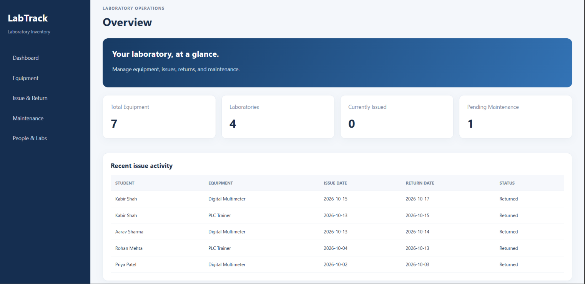
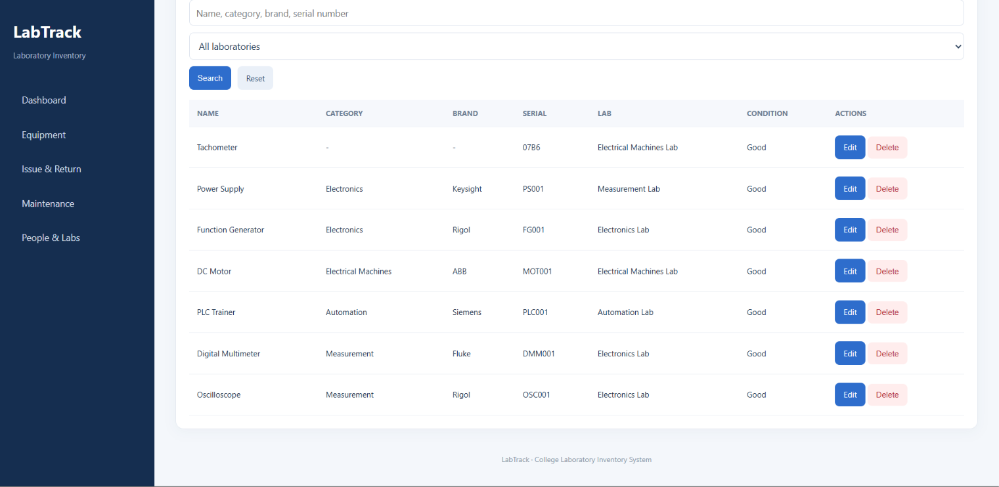
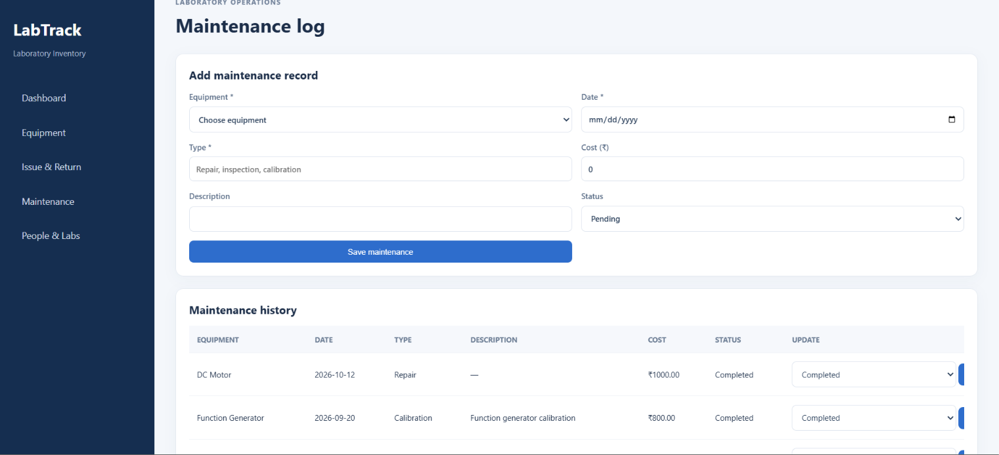

# LabTrack — Laboratory Equipment & Inventory Management System

A web-based inventory management system for college laboratories, built using **Python Flask** and **MySQL**.

---

## 📌 Overview

LabTrack helps manage laboratory equipment records, track equipment issued to students, record returns, and maintain organized inventory data in a centralized database.

## 🎯 Problem Statement

Manual laboratory inventory management can make it difficult to monitor equipment availability, maintain accurate transaction histories, and organize maintenance records. LabTrack provides a centralized web application connected to a relational database.

## ✨ Key Features

- **Equipment Management:** Add, view, edit, search, and filter equipment records.
- **Issue & Return Tracking:** Record equipment issued to students and track returns.
- **Availability Control:** Prevent equipment that is already issued from being issued again.
- **People Management:** Maintain student and faculty records.
- **Laboratory & Supplier Management:** Organize laboratory and supplier information.
- **Maintenance Records:** Store equipment maintenance information.
- **Database Integration:** Persist application data in MySQL.

## 🛠️ Technology Stack

| Component | Technology |
|---|---|
| Frontend | HTML, CSS, JavaScript |
| Backend | Python, Flask |
| Database | MySQL |
| Development Environment | VS Code, MySQL Workbench |
| Version Control | Git, GitHub |

## 🗄️ Database Design

The `lab_inventory` database contains seven tables:

- `STUDENT`
- `FACULTY`
- `LABORATORY`
- `SUPPLIER`
- `EQUIPMENT`
- `ISSUE_RETURN`
- `MAINTENANCE`

These tables organize inventory records and related issue/return transactions using relational keys.

## 🚀 Getting Started

### Prerequisites

- Python 3
- MySQL Server
- Git

### Installation

**1. Clone the repository**

```bash
git clone https://github.com/AsthaJain206/labtrack-laboratory-inventory.git
cd labtrack-laboratory-inventory
```

**2. Install dependencies**

```bash
python -m pip install -r requirements.txt
```

**3. Set up the database**

Create the `lab_inventory` database in MySQL and import the project's SQL schema and any required sample data.

**4. Configure environment variables**

Create a local `.env` file in the project directory with the following content:

```text
DB_PASSWORD=your_mysql_password
```

Replace the example value with your MySQL password. The application loads this value using `python-dotenv`. Never upload your `.env` file to GitHub.

**5. Start the application**

```bash
python app.py
```

**6. Open the website**

Visit http://127.0.0.1:5000 in your browser.

## 📷 Screenshots

### Dashboard


### Equipment Inventory


### Issue and Return Tracking


### Maintenance Management


### People and Laboratory Management


## 🧪 Testing

The equipment management and issue/return workflows have been tested locally. Further testing and validation can be added as the application develops.

## 🔮 Future Enhancements

- Role-based authentication and access control.
- Inventory reports and downloadable summaries.
- Automated maintenance reminders.
- Equipment usage analytics and dashboards.
- Enhanced validation and audit history.

## 🎓 Academic Information

| Detail | Information |
|---|---|
| Project | LabTrack — Laboratory Equipment & Inventory Management System |
| Course | Database Management Systems |
| Institution | MIT World Peace University (MIT-WPU) |
| Location | Pune, Maharashtra, India |

---

**Developed as an academic DBMS project.**
